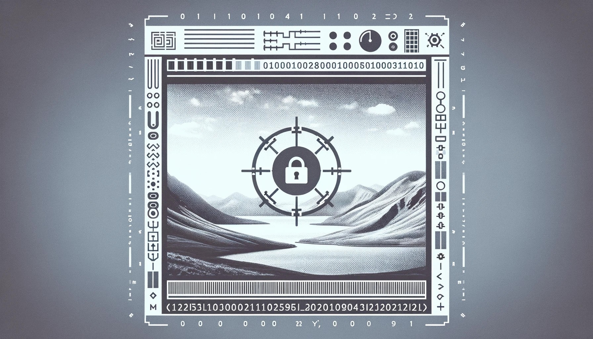
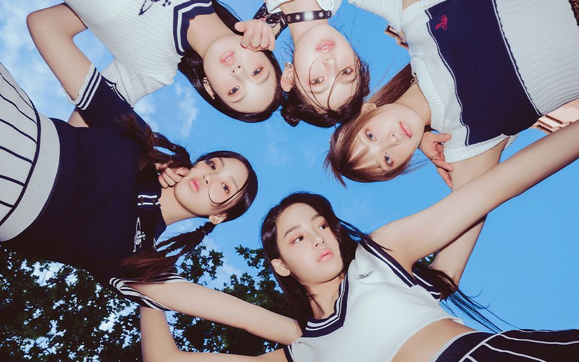
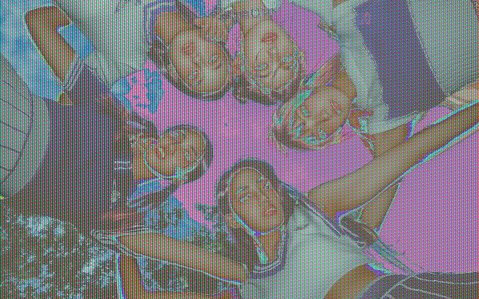
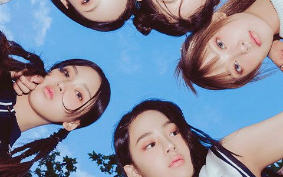
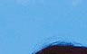

# RepetitiveInk

Course project (course and term not stated in the repo; commits are from April 2024). A MATLAB implementation of least/most-significant-bit image watermarking: a text watermark is embedded repeatedly across the pixels, and extraction is tested after cropping the image.



## What it shows

- `WatermarkProcessor.m`: embeds a bit-encoded text watermark, preceded by a marker, sequentially and repeatedly into pixel bits (LSB or MSB), and saves center crops.
- `main.m`: injects a watermark, saves crops at 100/50/25/10/5%, extracts the watermark from a crop, and plots an LSB autocorrelation check.
- Observed results are in the Result section below. They are the author's own single-image measurements and were not re-run when tidying this repo.

## How to run

Requires MATLAB (the autocorrelation step also uses the Signal Processing Toolbox). I could not run it here (no MATLAB or Octave available).

```
cp assets/input_image.tif .
matlab -batch main
```

`main.m` reads `input_image.tif` from the working directory and writes `output*.tif` there; the images in `assets/` are earlier outputs of this script.

## Assumption

- Input Image ([Appendix - Input Image](#input-image))
  - TIFF format / 960x600 / Works on RGB and grayscale.
- Input Text (Watermark)
  - String (~50 characters). Can work on longer ones
  - Longer the watermark, bigger the chance of it getting lost during cropping
- Output Image
  - TIFF format / Various size / Depends on the Input Image

## Approach

- Sequential Injection / Repetition on the whole image
  - LSB manipulation ([Appendix - Output Image #1](#output-image-1))
  - MSB manipulation ([Appendix - Output Image #2](#output-image-2))

1. Adding Marker to Watermark

- A marker is added to the watermark before embedding it into the image.
- It serves as a delimiter to identify the start of the watermark during extraction

2. Iterating Through Pixels:

- Iterate through all pixels in the image.
- Extract potential watermarks located after the marker.

3. Handling Marker in the Middle:

- If the marker is found in the middle of extracting a potential watermark:
  1. Dispose of the current potential watermark.
  2. Start the extraction process again to find the next potential watermark.

4. Selecting Final Watermark:

- After going through the whole image, analyze potential watermarks.
- Choose the watermark with the maximum length

## Result

- Injected watermark `Watermark and Copyright by Euisuh John Jeong`
  - Time taken to inject - 10 seconds
- Original Image, no crop ([Appendix - Output Image #1](#output-image-1))
  - No problem retrieving the watermark.
  - Time taken to extract - 0.04 seconds
- Cropping 50% ([Appendix - Output Image #3](#output-image-3))
  - Image cropped to the central 50% of its original height and width.
  - No problem retrieving the watermark.
  - Even if the watermark is partially cropped, the algorithm starts to find the next marker and successfully retrieves the remaining watermark.
  - Time taken to extract - 0.02 seconds
- Cropping 25% ([Appendix - Output Image #5](#output-image-5))
  - Image cropped to the central 25% of its original height and width.
  - No problem retrieving the watermark.
  - Time taken to extract - 0.02 seconds
- Cropping 10% ([Appendix - Output Image #4](#output-image-4))
  - Image cropped to the central 10% of its original height and width.
  - Error occurred when retrieving the watermark `Watermark and Cop Euisuh John Jeong`
    - Retrieves 15-20 characters from both front and back of the watermark
  - Time taken to extract - 0.4 seconds
- Cropping 5% ([Appendix - Output Image #6](#output-image-6))
  - Image cropped to the central 5% of its original height and width.
  - Error occurred when retrieving the watermark `Watermarohn Jeong`
    - Retrieves 7-10 characters from both front and back of the watermark
  - Time taken to extract - 0.1 seconds

## Appendix

### Input Image



TIFF format / 960x600 / RGB

### Output Image 1


TIFF format / 960x600 / RGB / Sequential injection / Repetition / LSB manipulation

### Output Image 2



TIFF format / 960x600 / RGB / Sequential injection / Repetition / MSB manipulation

### Output Image 3



TIFF format / 480x300 / RGB / Sequential injection / Repetition / MSB manipulation / Image cropped to preserve the central 50% of both width and height, maintaining the middle portion intact

### Output Image 4



TIFF format / 96x30 / RGB / Sequential injection / Repetition / MSB manipulation / Image cropped to preserve the central 10% of both width and height, maintaining the middle portion intact

### Output Image 5


TIFF format / 240x150 / RGB / Sequential injection / Repetition / MSB manipulation / Image cropped to preserve the central 25% of both width and height, maintaining the middle portion intact

### Output Image 6


TIFF format / 48x30 / RGB / Sequential injection / Repetition / MSB manipulation / Image cropped to preserve the central 5% of both width and height, maintaining the middle portion intact
